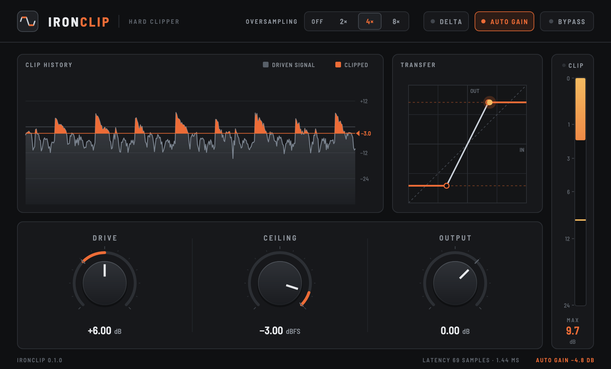

<p align="center">
  <picture>
    <source media="(prefers-color-scheme: dark)" srcset="assets/logo-dark.svg">
    
  </picture>
</p>

<p align="center"><b>A simple, powerful, no-nonsense hard clipper.</b><br>
Free and open source. VST3, CLAP and AU for macOS and Windows.</p>

<p align="center">
  <a href="https://github.com/BTFLV/IronClip/releases/tag/rolling"><b>⬇ Download the latest release</b></a>
  &nbsp;·&nbsp;
  <a href="#installation">Installation</a>
  &nbsp;·&nbsp;
  <a href="#building-from-source">Build from source</a>
</p>

<p align="center">
  
</p>

## What it does

IronClip cuts every peak above the ceiling flat — genuine, symmetric hard
clipping with no hidden saturation or soft knee. It adds the tools that make a
clipper practical to use:

- **Drive, Ceiling, Output** — push the signal into the ceiling, set where it
  clips, trim the result.
- **Oversampling: Off, 2×, 4×, 8×** — linear-phase oversampling to keep
  aliasing out of the audible band. Off is truly zero-latency.
- **Delta** — hear only what the clipper removes, perfectly time-aligned in
  every oversampling mode.
- **Auto Gain** — matches the output loudness to the input so you compare
  the sound, not the level.
- **Clip meter** — shows how far the signal exceeds the ceiling, with peak
  hold and a resettable maximum.
- **Clip history and transfer curve** — see exactly what is being cut, and
  the shape of the curve you set.
- **Bypass** — crossfades to the dry signal, delayed to match the processing
  latency, so switching never jumps in time or clicks.

No accounts, activation, telemetry, updaters or background processes. Unzip,
copy, done.

## Download

The [**Latest IronClip Release**](https://github.com/BTFLV/IronClip/releases/tag/rolling)
always holds the newest build that passed all tests and plug-in validators.

| Platform | Formats | Package |
| --- | --- | --- |
| macOS 11 or later, Apple Silicon and Intel (universal) | VST3, CLAP, AU | `IronClip-macOS-universal.zip` |
| Windows 10/11, 64-bit | VST3, CLAP | `IronClip-Windows-x64.zip` |

## Installation

Unzip the package and copy the plug-ins you need, then rescan plug-ins in
your host. Each ZIP includes an `INSTALL.txt` with the same steps.

**macOS** (for your user; use `/Library/Audio/Plug-Ins/…` for all users)

| Format | Copy to |
| --- | --- |
| VST3 | `~/Library/Audio/Plug-Ins/VST3/IronClip.vst3` |
| CLAP | `~/Library/Audio/Plug-Ins/CLAP/IronClip.clap` |
| AU | `~/Library/Audio/Plug-Ins/Components/IronClip.component` |

**Windows**

| Format | Copy to |
| --- | --- |
| VST3 | `C:\Program Files\Common Files\VST3\IronClip.vst3` (the whole folder) |
| CLAP | `C:\Program Files\Common Files\CLAP\IronClip.clap` |

### Signing

The release notes state whether the macOS build is signed and notarized.
**Unsigned macOS builds are blocked by Gatekeeper** until you remove the
download quarantine flag:

```sh
xattr -dr com.apple.quarantine ~/Library/Audio/Plug-Ins/VST3/IronClip.vst3
xattr -dr com.apple.quarantine ~/Library/Audio/Plug-Ins/CLAP/IronClip.clap
xattr -dr com.apple.quarantine ~/Library/Audio/Plug-Ins/Components/IronClip.component
```

The Windows plug-ins are not code-signed. On Windows 11 with Smart App
Control switched on, Windows may block unsigned plug-ins.

## Controls

| Control | Range | What it does |
| --- | --- | --- |
| **Drive** | −12 to +24 dB | Gain before the clipper. More drive, more clipping. |
| **Ceiling** | −30 to 0 dBFS | The clipping threshold, identical for positive and negative peaks. |
| **Output** | −24 to +12 dB | Gain after the clipper. |
| **Oversampling** | Off, 2×, 4×, 8× | Clips at a higher sample rate to suppress aliasing. Adds 63, 69 or 71 samples of latency, reported to the host for delay compensation. |
| **Delta** | on / off | Outputs only the removed part of the signal (driven input minus clipped signal, at the output gain). |
| **Auto Gain** | on / off | Applies the gain that brings the output back to the input's loudness (shown in the footer). |
| **Bypass** | on / off | Smoothly crossfades to the latency-aligned dry signal. |

**Mouse:** drag knobs vertically; hold **Shift** or **Ctrl/Cmd** for fine
adjustment; **double-click** to reset; **click the value** to type a number;
the scroll wheel works too. In VST3 hosts, right-click a control for the
host's parameter menu. Drag the bottom-right corner to resize the window (75–200 %).

**Clip meter:** the bar shows how many dB the driven signal exceeds the
ceiling, the amber line holds recent peaks, and the number below is the
largest overshoot since you last clicked it.

## How it works

- **Clipping** is `clamp(input × drive, −ceiling, +ceiling) × output`. Parameter
  changes are smoothed over 20 ms; the smoothing moves the threshold, never
  the shape — every sample is still clipped hard.
- **Oversampling** uses cascaded linear-phase half-band FIR filters designed
  with the Parks–McClellan method ([design script](tools/design_halfband.py)):
  flat to 0.45 × the sample rate (within 0.0002 dB for the full round trip)
  with at least 104 dB of alias rejection per stage. The latency is padded to
  a whole number of samples, so the dry signal used by Bypass and Auto Gain
  lines up sample-exactly; Delta is computed inside the oversampled domain and
  is aligned by construction.
- **Auto Gain** compares the long-term energy of the driven and clipped
  signals (0.4 s time constant), so a drive change is compensated instantly
  and only the level lost to clipping is measured. During silence the last
  estimate is held instead of drifting.
- **Real-time safety:** no allocation, locks or system calls on the audio
  thread; denormals are flushed; NaN and infinite input cannot poison the
  filters. Mono and stereo, any buffer size, 32- and 64-bit host buffers.

In the test suite's harshest case (a 6.5 kHz sine driven about 23 dB past
the ceiling at 48 kHz) the energy of alias products relative to the harmonics
measures −10.9 dB without oversampling, −20.2 dB at 2×, −31.1 dB at 4× and
−44.5 dB at 8×. Processing cost on an Apple M4, measured with the included
benchmark (float, stereo, 48 kHz): about 1.3 ns per sample and channel with
oversampling off — roughly 0.013 % of one CPU core per instance — and 11, 19
and 31 ns at 2×, 4× and 8×.

## Building from source

**Requirements**

- CMake 3.25 or newer, Git, Bash (Git Bash on Windows)
- macOS: Xcode or the Command Line Tools (macOS 11 SDK or newer); Ninja is
  recommended
- Windows: Visual Studio 2022 or newer with the C++ desktop workload

```sh
git clone --recurse-submodules https://github.com/BTFLV/IronClip.git
cd IronClip
scripts/bootstrap.sh                 # pinned iPlug2 SDKs and prebuilt Skia
cmake -S . -B build -G Ninja         # on Windows: cmake -S . -B build -A x64
cmake --build build --config Release
```

The plug-ins end up in `build/out`. macOS builds are universal by default
(`-DCMAKE_OSX_ARCHITECTURES=arm64` builds for Apple Silicon only). Set
`-DIPLUG_DEPLOY_PLUGINS=ON` to copy them into your plug-in folders after
each build.

**Tests and tools**

```sh
ctest --test-dir build --output-on-failure     # DSP test suite
build/ironclip-benchmark                       # DSP cost per oversampling mode
scripts/fetch-validators.sh                    # VST3 validator, clap-validator, pluginval
scripts/validate.sh build/out                  # run them against the build
scripts/package.sh build/out dist              # release ZIP for this platform
```

To build only the DSP library and tests (no SDKs needed), configure with
`-DIRONCLIP_BUILD_PLUGIN=OFF`. The screenshot above is rendered by
[`tools/screenshot`](tools/screenshot/ClapScreenshot.mm), a minimal CLAP host
that runs the real plug-in (configure with `-DIRONCLIP_RENDERER=CPU
-DIRONCLIP_BUILD_TOOLS=ON`).

**Project layout**

| Path | Contents |
| --- | --- |
| `src/dsp` | Framework-independent DSP engine (clipper, oversampler, smoothing, telemetry) |
| `src/plugin` | iPlug2 plug-in: parameters, state, format glue |
| `src/ui` | Editor, controls and theme (iPlug2 IGraphics with Skia) |
| `tests` | DSP tests and benchmark |
| `scripts` | Dependency bootstrap, validation, packaging, signing, release publishing |
| `tools` | Filter and logo generators, screenshot host |

Every push to `main` updates the rolling release via the *Release* workflow; see
[docs/RELEASING.md](docs/RELEASING.md), including how to enable macOS signing
and notarization.

## License

IronClip is released under the [MIT License](LICENSE).

It is built with [iPlug2](https://github.com/iPlug2/iPlug2) and
[Skia](https://skia.org), supports VST3 through the
[Steinberg VST 3 SDK](https://github.com/steinbergmedia/vst3sdk) and CLAP
through the [CLAP SDK](https://github.com/free-audio/clap), and uses the
[Barlow](https://github.com/jpt/barlow) typeface. These and the other
components included in the binaries are listed with their licenses in
[THIRD_PARTY_NOTICES.md](THIRD_PARTY_NOTICES.md).

VST is a registered trademark of Steinberg Media Technologies GmbH.
